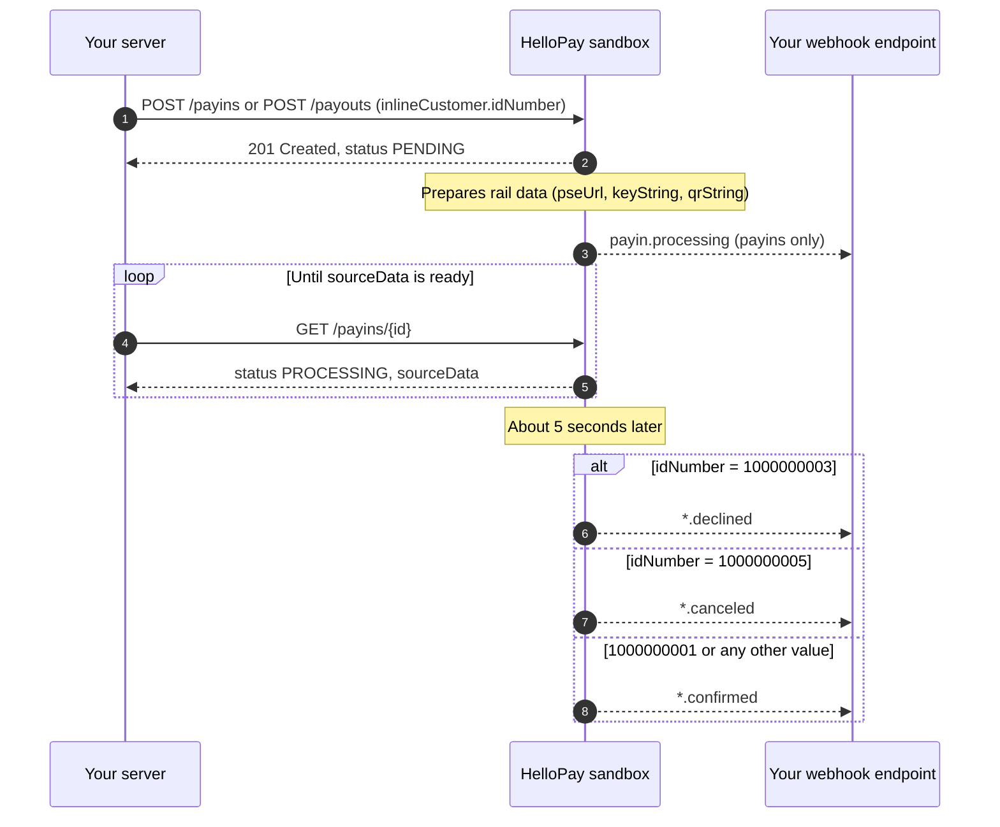

import { SequenceFlow } from "/snippets/flows.jsx";

The sandbox lets you validate your whole integration before going live. It uses the same requests and responses as production.

| | Value |
| --- | --- |
| API base URL | `https://api.stg.hellopay.com.co` |
| Portal | [portal.stg.hellopay.com.co](https://portal.stg.hellopay.com.co) |
| API key | Create one in the sandbox portal. See [Authentication](/getting-started/authentication) |

No real money moves. The sandbox does not connect to PSE, Bre-B, or Nequi: it simulates their behavior, including the async `sourceData` updates and webhooks.

## Test document numbers

The value of `inlineCustomer.idNumber` decides the final status of a payin or payout:

| `inlineCustomer.idNumber` | Final status | Webhook |
| --- | --- | --- |
| `1000000001` | `CONFIRMED` | `payin.confirmed` / `payout.confirmed` |
| `1000000003` | `DECLINED` (`errorCode: SANDBOX_DECLINED`) | `payin.declined` / `payout.declined` |
| `1000000005` | `CANCELED` | `payin.canceled` / `payout.canceled` |
| Any other value | `CONFIRMED` | `payin.confirmed` / `payout.confirmed` |

<Tip>
  Use `1000000001` when you want a success, rather than a random number. Your tests then read clearly and keep working if the default changes.
</Tip>

## Timing

<Visibility for="humans">
  <SequenceFlow
    title="Sandbox payin timeline"
    steps={[
      { actor: "Your server", title: "POST /payins", detail: "status: PENDING", icon: "server" },
      { actor: "HelloPay sandbox", title: "Prepares the rail data (pseUrl, keyString, qrString)", detail: "payin.processing", icon: "gears" },
      { actor: "Your server", title: "Polls GET /payins/{id} for sourceData", icon: "arrows-rotate" },
      { actor: "HelloPay sandbox", title: "About 5 seconds later, sets the final status from idNumber", detail: "payin.confirmed", icon: "flag-checkered" },
    ]}
  />
</Visibility>

1. The create response returns `status: "PENDING"`.
2. Within a few seconds, HelloPay prepares the rail data and moves the transaction to `PROCESSING`. Payins send `payin.processing`. Payouts do not send a webhook for this step.
3. About 5 seconds later, the transaction reaches the final status from the table above, and HelloPay sends the matching webhook.

## Rail behavior in the sandbox

| Rail | What the sandbox returns |
| --- | --- |
| `PSE` | `sourceData.pseUrl` is `null` at creation, then a sandbox redirect URL |
| `BRE_B` | `sourceData.keyString` such as `@SANDBOX5AF43BE4F5`. `QR_CODE` also returns a fixed test QR in `sourceData.qrString` |
| `NEQUI` | `sourceData.phone` equals `inlineCustomer.phone`. No real Nequi request is sent |
| Payouts (`BRE_B`) | `targetData.keyString` echoes the destination key. The key is not checked: the outcome depends only on `idNumber`, and `targetData.bank` is not added. Use `@alphamunKey01` to test `GET /breb/keys/{keyString}` |

## Suggested test plan

- [ ] PSE payin with `1000000001`: `pseUrl` appears when you poll, then `payin.confirmed`.
- [ ] Payin with `1000000003`: `payin.declined` with `errorCode: SANDBOX_DECLINED`.
- [ ] Payin with `1000000005`: `payin.canceled`.
- [ ] Bre-B `QR_CODE` payin: `qrString` appears when you poll.
- [ ] Nequi payin with `1000000001`: `sourceData.phone` matches the request, then `payin.confirmed`.
- [ ] Bre-B payout with `1000000001`: validate the key with `GET /breb/keys/{keyString}`, then `payout.confirmed`.
- [ ] Payment link: complete one and receive `paymentlink.completed`; let another expire and receive `paymentlink.expired`.
- [ ] Your webhook endpoint rejects requests without your authentication header.

## Sequence diagram

